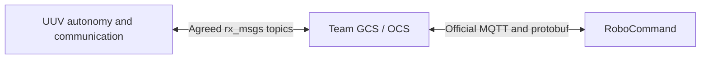

# Issue 13: corrected ownership and remaining UUV work

Baseline: `92cd50e`, reviewed October 10, 2026. This is an instruction document, not an implementation or completion claim. It supersedes the GCS ownership and public-envelope recommendations in the earlier Step 2 guide. Preserve the competition rules and UUV safety requirements in [the approved plan](issue13_rules_and_implementation_plan.md).

## 1. Responsibility boundary

The UUV talks to the team GCS through agreed ROS messages. The GCS provides the team's Operator Control Station (OCS) connection to RoboCommand. OCS credentials and access are unnecessary for local UUV implementation and mock verification. This boundary follows [Handbook §3.4](https://robonation.gitbook.io/robotx-2026-team-handbook/section-3-autonomy-challenge/3.4-communications-protocol) and the [shared interface at `2946a98`](https://github.com/Barunastra-ITS/rx-sos-communication-itsn/blob/2946a98a905e2e8fac779b4c02316c0e9dcd8f87/README.md).



| Work | Owner | UUV developer's deliverable |
| --- | --- | --- |
| Mission start, lifecycle, safety, navigation, survey and surface verification | UUV | Working nodes and observable acceptance checks |
| Correct public topics, payloads and telemetry | UUV | Exact agreed `rx_msgs` interface |
| Durable local report acceptance and publication recovery | UUV | Recoverable local state and documented limitations |
| RunDeclaration, official envelopes, team/vehicle attribution, OCS report/request sequences | GCS | Provide UUV interface expectations and sample payloads; do not implement the OCS stack here |
| MQTT broker connection, credentials and protobuf serialization | GCS | No UUV implementation requirement |
| GCS durable ingestion and official-server receipt | GCS | Joint test when their implementation is available |
| DDS routing, QoS, retries and report receipt/run attribution | Joint | Provide UUV settings and a local mock; agree the deployed contract |
| Real magnetic repair, acoustic localization and tier-specific optical decoding | UUV, with relevant hardware/perception contributors | Evidence for the declared task tier; no OCS dependency |

Only the agreed public topics cross the vehicle boundary. Camera, MAVROS, `/banyu/...` and TF traffic remain private. Domains 40 for UUV and 10 for GCS are team conventions. A local test can use an isolated domain; a deployed domain-routing test is a separate check.

## 2. Correct the earlier instructions

| Earlier instruction or claim | Correction |
| --- | --- |
| GCS must ingest `banyu_msgs/Task2Submission` as the authoritative public report | Keep this envelope internal. An extension requires agreement and changes in the shared interface and GCS; it is not the current contract. |
| `PipelineSurvey` and `ResourceDelivery` are legacy copies | They are the agreed public `rx_msgs` reports. Removing the old CRC32 artifacts does not make these types legacy. |
| UUV must persist official OCS sequence mappings | UUV persists local run/report identities. GCS owns official envelope sequences and mappings. |
| No second ROS publication proves no duplicate official report | Local publication count does not prove GCS or official-server behavior. Recovery can require replay; receiver semantics must be agreed. |
| A local adapter named `GcsSubmissionAdapter` proves GCS ingestion | It currently runs in the UUV launch and converts internal data to public ROS reports. Its name does not make it the external GCS. |
| Step 2 cannot finish without implementing the GCS backend | Local Step 2 can finish against the agreed ROS contract and mock boundary. Joint delivery guarantees remain separately recorded. |
| Every acceptance gate passed because fixture tests passed | Record unit/fixture passes separately from full mission, hardware, routing and official-server evidence. |
| RunCoordinator uses SQLite | Its implementation uses a file journal. Describe the actual persistence implementation. |
| Near-zero relative altitude proves water-surface calibration | It proves neither the physical surface nor a valid water datum by itself. Validate calibration provenance. |
| All remaining defects from `588e211` still need implementation | The three earlier regressions are registered and pass at `92cd50e`; preserve them. The newly reproduced adapter recovery failure remains open. |

Do not encode missing run/report IDs into `header.frame_id`, infer them from arrival order, or silently change `rx_msgs` fields. The current survey/delivery schemas lack those IDs. That limits cross-run receipt/deduplication guarantees, but does not invalidate their required use.

## 3. Public ROS contract to keep

These are the interfaces audited at the pinned shared revision:

| Direction from UUV | Topic | ROS type |
| --- | --- | --- |
| Subscribe | `/system/mission/course` | `rx_msgs/msg/Course` |
| Subscribe | `/system/mission/command` | `rx_msgs/msg/Command` |
| Publish | `/system/mission/status` | `rx_msgs/msg/MissionStatus` |
| Publish | `/system/vehicle/uuv/heartbeat` | `rx_msgs/msg/Heartbeat` |
| Publish | `/system/vehicle/uuv/task2/pipeline_survey` | `rx_msgs/msg/PipelineSurvey` |
| Publish | `/system/vehicle/uuv/task2/delivery` | `rx_msgs/msg/ResourceDelivery` |
| Publish | `/system/vehicle/uuv/task4/incident_ack` | `rx_msgs/msg/IncidentAck` |
| Publish | `/system/vehicle/uuv/task4/readiness` | `rx_msgs/msg/ReadinessReport` |

Retain a 2 Hz production heartbeat, truthful readiness and authoritative `current_task` transitions. Preserve received sequence references. Continue using nonzero run IDs as the selected BANYU policy; the approved plan distinguishes that policy from an explicit handbook prohibition.

## 4. Baseline evidence and open work

At `92cd50e`, all eight focused packages built and 272 registered C++ tests passed. Six communication smoke checks passed. Message files matched shared revision `2946a98` byte for byte. A 30.5-second heartbeat probe recorded 61 messages with a mean interval of 0.4999975 seconds.

The rate probe's aggregate telemetry-field flag was false and retained no individual samples. Treat it as rate evidence only. Registered/smoke telemetry assertions passed; a future rate probe should retain raw samples and distinguish startup from steady operation.

The supplemental `LocalAuditRecoversJournaledButUnpublishedReport` probe failed: expected one survey, received zero. It seeded the real adapter's acceptance journal to model a crash between journaling and publication, then replayed the same submission. This is a deterministic recovery-state reproduction, not a process-kill test.

Existing smoke tests inject lifecycle, survey evidence and seal authorization, enable direct report copies, and force domain 42. They do not prove the default adapter path, full Gazebo execution, physical surfacing, or real GCS receipt.

Implement the following work in order. Register meaningful regressions with each behavior change rather than treating this document as executable test evidence.

## 5. Work A: restore the public/private topic boundary

Owner: UUV. No GCS source or credentials required.

Targets: `banyu_communication/src/uuv_comm_node.cpp`, `src/gcs_submission_adapter.cpp`, their tests, `banyu_bringup/config/task2_params.yaml`, launch wiring, and `sos_gcs_mock.py`.

1. Change the internal submission topic default and both YAML entries to a private name, for example `/banyu/communication/task2_submission`. This name is a proposed internal implementation choice.
2. Update the local adapter subscription and test/mock references together. Search the whole repository for the old topic so no launch override leaves it public.
3. Keep all public survey/delivery names and `rx_msgs` types unchanged. Retain one production report-conversion path; avoid simultaneously publishing direct copies and adapter output.
4. Keep the internal envelope's run, epoch, kind, immutable payload and report identity for local transactions and diagnostics.
5. Document the adapter as a UUV-side report publisher. Renaming the class is optional and should not delay the behavioral fix.

Acceptance: a nominal report reaches a mock subscribing only to standard `rx_msgs` topics. No custom `banyu_msgs` report topic is routed across the GCS boundary. The default adapter path works with direct copies disabled.

## 6. Work B: recover reports without suppressing unsent data

Owner: UUV for local recovery; joint agreement for receiver-confirmed delivery guarantees.

Targets: `gcs_submission_adapter.cpp/.hpp`, `survey_reporting.cpp/.hpp`, outbox/coordinator integration and their tests.

Current failure: acceptance is appended before `survey_pub_->publish()`. On restart, the accepted identity is loaded; identical replay returns from the deduplication branch without publication. A report can therefore be lost permanently in that crash window.

Recommended local architecture, subject to the agreed replay policy:

1. Persist enough immutable payload to reconstruct the public message, not only a key or hash.
2. Distinguish local acceptance, pending publication and publication attempted. These are engineering states, not official scoring states. A publication-attempt marker is not evidence of receiver receipt.
3. On startup, validate and recover pending records. Preserve existing journals through a documented migration or fail with a diagnostic; do not silently discard accepted reports.
4. Check storage errors. If required durable acceptance cannot be written, return an actionable failure and retain existing data. Document the atomic-write/fsync strategy and test the recovery states it promises.
5. Suppress conflicts and repeated in-process submissions without suppressing necessary recovery. Record identity, payload and publication state consistently.
6. Re-publish only under a documented run/receiver policy. Do not silently forward an old run's report during a newer run when the public schema cannot identify the original run. Preserve it locally and expose the unresolved-delivery diagnostic instead.
7. Keep accepted reports recoverable after abort according to the existing seal policy. Recovery must not restore mission activity, authorize motion or overwrite the newer run's ledger.
8. Use receiver receipts only if the GCS/shared interface supports an agreed receipt contract. Do not invent a survey scoring ACK or claim exactly-once delivery from ROS `publish()`.

The correct local promise is durable acceptance plus recoverable publication intent. Across the crash-after-publication boundary, replay can duplicate transport messages. Guaranteeing one official report requires receiver cooperation; simply moving the journal write after publication is insufficient.

Required probes:

| Probe | Observable result |
| --- | --- |
| Acceptance persisted, first publication absent, restart and retry | Report can reach the mock under the permitted recovery policy; no permanent suppression |
| Crash before durable acceptance | No invented accepted report; retry can establish a valid transaction |
| Same identity with changed payload, or reused report ID | Rejected with diagnostics; original record preserved |
| Required journal storage fails | No claimed durable success; explicit error |
| Adapter restarts after publication; receiver starts late | Cache/publication recovery follows the documented policy; prior receive vectors cannot satisfy the test |
| New run begins while an older accepted report remains | No silent attribution of old data to the new run |
| SURVEY and DELIVERY each recover | Independent payloads and states; neither stands in for the other |

Replace the existing unconditional "restart must never publish twice" expectation with a policy-specific check. A GCS mock that deduplicates reports needs an actual agreed identity mechanism; it must not pretend the current public schema contains one.

## 7. Work C: connect qualified buoy and pipeline-end evidence

Owner: UUV. A position observation from another vehicle is an optional joint interface input, not something already present in `Course`.

Targets: `survey_evidence_node.cpp`, `pipeline_end_node.cpp`, the relevant perception/acoustic producer, private contracts and `mission.launch.py`.

The local launch has consumers for `ActiveBuoyFix` and run-tagged `PipelineEndCandidate`, but the audit found no non-test publishers. Raw start-buoy GPS leaves pinger confirmation false. Keep these guards: missing proof should block the report, not be replaced with fabricated coordinates or flags.

1. Identify and wire the real active-buoy producer. Use green-indicator and active-pinger evidence under the approved identification policy, with observed position, uncertainty, course/run association and endpoint identity. Preserve truthful timestamps and revisions.
2. If observation comes from GCS/UAV/USV, agree its public type/topic first. `Course` does not contain active-buoy coordinates; do not assume an undocumented field exists. Adapt the agreed observation to the private UUV contract locally.
3. Identify and wire an end-candidate producer based on observed task geometry. Ordinary detection loss, elapsed travel time or four accepted nodes alone must not fabricate a confirmed end.
4. Bind end candidates to the current run/epoch and freshness checks. Reject stale/future or mismatched evidence.
5. Add launch, installation and dependencies for new nodes. Put every new/renamed parameter in its matching YAML section.
6. Provide separate simulation sensor/geometry fixtures. A fixture may provide known observations, but cannot be used to claim physical sensor validation.

Acceptance: the actual tracker/evidence/mission path builds a valid four-node report from upstream inputs without the test publishing a preassembled survey or asserting verification flags on its behalf. Missing or conflicting active-end/end evidence blocks publication with a diagnostic.

## 8. Work D: validate node identity and survey order

Owner: UUV. Requirements follow [Handbook §3.3.3](https://robonation.gitbook.io/robotx-2026-team-handbook/section-3-autonomy-challenge/3.3-mission-task-descriptions/3.3.3-mission-task-2-infrastructure-survey-and-repair) and the hardware/Q&A reconciliation in the approved plan.

Targets: `ring_tracker.cpp`, `ring_tracker_node.cpp`, camera/localization inputs and Task 2 configuration.

Centerline projection now exists; the old instruction to add `has_path_distance` wiring is historical. The remaining concern is evidentiary validity: vehicle pose is projected onto fixed YAML geometry, and a valid projection can mark physical identity/order verified without a lateral-distance or ambiguity rejection.

1. Specify the centerline frame, geodetic/local origin, geometry source and calibration validity. Keep world-specific geometry in the appropriate simulation configuration.
2. Establish the physical node position/association from calibrated observations, or document and validate a constrained centered-observation method with bounded error. Vehicle pose alone is insufficient.
3. Reject far-off-pipeline projections and ambiguous associations near bends or overlapping segments. Choose bounds from measured sensor/localization uncertainty, not an invented competition tolerance.
4. Preserve identity during backtracking, reacquisition and repair. Preserve the first qualified original RED/GREEN state.
5. Build exactly four statuses in pipeline order beginning nearest the confirmed active endpoint. Reverse the orientation when the opposite endpoint is active; do not globally sort by buoy distance.
6. Leave uncertain identity/order unverified and return a diagnostic rather than forcing a successful array.

Acceptance fixtures: bent/U-shaped geometry, both active ends, forward and reverse revisits, changed post-repair colors, missed observations, far-off projections, overlapping/ambiguous nodes, and attempted fifth-node manufacture. Then exercise the real detector/tracker path with known image/geometry inputs.

## 9. Work E: prove calibration and surfacing against a water datum

Owner: UUV. Verified surfacing is the selected BANYU reporting policy; do not label it a universal handbook mandate.

Targets: `calibrated_depth_node.cpp`, Surface action, `SurfaceGuard` and their configuration/tests.

The ACTIVE-heartbeat calibration regression now passes. However, pre-ACTIVE relative altitude near zero is still not independent proof of the water surface. Separate valid telemetry from an established water datum.

1. Specify a verified calibration operation or validated persisted/configured datum, with source, offset, calibration identity and validity conditions.
2. Ensure underwater startup/restart and repeated lifecycle messages cannot establish a new surface datum merely from relative altitude or map z.
3. Make the Surface action and communication guard use consistent water-relative depth semantics. Account for the distinction between sensor timestamp and receipt time for headerless input.
4. Require current-run Surface completion and independent fresh depth held continuously within the configured surface tolerance. Paused ROS time must not keep old proof valid indefinitely.
5. Preserve the already passing abort/seal and same-run epoch regressions; do not treat them as unresolved baseline bugs.

Acceptance: proven calibration → dive → sustained resurfacing succeeds; uncalibrated, stale, invalid, underwater-restart and failed-run cases do not authorize a scoring report. Record which results use synthetic telemetry versus SITL/bench evidence.

## 10. Work F: connect course data to navigation and acoustics

Owner: UUV. GCS publishes `Course`; UUV must use its relevant fields.

Targets: course subscriptions/context, navigation/geofence and actual acoustic frontend/homing consumers. Receiving/storing course data in the ledger is not the acoustic-guidance integration checked off in Issue 13.

1. Deliver validated course boundary and identity to the navigation constraint consumer. Demonstrate that its planned/output motion respects the boundary.
2. Deliver `pinger_freq_hz` to the receiver/filter and homing consumer. Expose the selected frequency and diagnose unsupported input; do not silently retain a default.
3. Supply the observed active-buoy position to Task 2 transit/orientation. Static mission YAML is a fixture unless validated for the actual run.
4. Test compatible retained Course QoS with late subscribers/restarts. The public Course has no header; do not claim sensor acquisition metadata it cannot carry.
5. Freeze or explicitly validate mid-run context changes so an update cannot silently reverse a pinned survey.

A mock acoustic consumer can verify forwarding, but cannot prove acoustic homing. Record hardware/frontend availability honestly and track full sensing separately if the implementation is outside the immediate communication milestone.

## 11. Work G: make Task 4 scope and readiness truthful

Owner: UUV for behavior; joint agreement for confirmation correlation. Follow [Handbook §3.3.5](https://robonation.gitbook.io/robotx-2026-team-handbook/section-3-autonomy-challenge/3.3-mission-task-descriptions/3.3.5-mission-task-4-dynamic-incident-response).

Issue 13's checklist permits stub listeners, while its requirements describe full incident behavior. Record explicitly whether full Task 4 is included in this issue or assigned to a follow-up. The current assistance callback ACKs and publishes readiness immediately; even a stub must not claim station readiness it has not achieved.

For a documented stub: retain correct command filtering and ACK behavior, suppress premature readiness, publish an unsupported/not-implemented diagnostic, and do not advertise full Task 4 support.

For full implementation:

1. ACK assistance with the original `command_seq`, suspend the relevant mission execution, transit to the requested station using the existing execution arbitration, and verify arrival/hold before readiness.
2. Resume only on the correctly correlated readiness confirmation. Preserve the schema's sequence-reference semantics; do not assume the command and official report sequences are identical.
3. Apply keep-out restrictions until all-clear or run end; ACK keep-out and all-clear. Apply moving-object avoidance without inventing an ACK.
4. Test target filtering, repeated/stale commands, distant stations, aborted transit, wrong confirmations and hazards affecting planned motion. None may bypass RC/GUIDED safety or restart a terminal run.

A passing test that receives readiness immediately after assistance is evidence of the stub, not transit compliance. Change that assertion when truthful readiness is implemented.

## 12. Work H: local integration and Gazebo acceptance

Owner: UUV. Use a mock GCS; no OCS access is needed.

Keep three distinct verification levels:

| Level | Real components | Permitted substitutes | What it proves |
| --- | --- | --- | --- |
| Communication contract | Comm and local adapter | Mission/telemetry fixtures, explicitly labeled | Topic/type, payload, rate and selected transaction behavior |
| Mission integration | Mission/coordinator, execution, tracker/evidence, depth, comm and adapter | External sensors/FCU/GCS at documented boundaries | Node wiring and lifecycle/report transaction behavior |
| Gazebo + SITL | Real mission stack, simulated FCU and physics-backed motion | Simulated sensors/environment and mock GCS | Issue's simulated hold/start/traverse/surface/report acceptance |

For nominal integration use default production report routing with direct copies disabled. The GCS mock subscribes only to the standard public interface. It may publish commands/course, but must not replace the real mission's lifecycle or seal service.

Nominal sequence: operator/simulation authorization and ready hold → accepted addressed start → current-run resets → qualified active endpoint → four original node observations and verified traversal completion → Surface action and continuous calibrated depth proof → durable local report acceptance → public report received by mock → terminal task NONE. Keep Core and higher-tier requirements distinct; missing repair/code evidence must not be labeled an Advanced/Disruptive pass.

Negative integration cases: direct Task 2 Trigger start; zero/duplicate/conflicting run start; stale-run observations; sparse/ambiguous survey; abort/failure before report; calibration loss; paused clock; adapter restart; delayed old-run authorization; and receiver disconnect/reconnect under the agreed replay policy.

For headless SITL, diagnose actual RC input/freshness and use the approved simulation authorization approach from Step 3 if needed. Do not set `rc_fresh=true` in production to make a test pass or bypass hardware protection. Full headless execution remains a separate milestone from fixture communication passes.

Build and registered checks from bash:

```bash
cd /home/erlangga/Desktop/ros2_ws_robotx
source /opt/ros/jazzy/setup.bash
colcon build --packages-select rx_msgs banyu_msgs
source install/setup.bash
colcon build --packages-select banyu_guidance banyu_vehicle_interface \
  banyu_vehicle_execution banyu_communication banyu_mission \
  banyu_detection banyu_bringup
source install/setup.bash
ROS_DOMAIN_ID=42 colcon test --executor sequential \
  --packages-select banyu_msgs banyu_guidance banyu_vehicle_interface \
    banyu_vehicle_execution banyu_communication banyu_mission \
    banyu_detection banyu_bringup \
  --ctest-args -j1 --return-code-on-test-failure
colcon test-result --test-result-base build --verbose
```

For launch inspection, use the files actually present in this checkout:

```bash
ROS_DOMAIN_ID=40 ros2 launch banyu_bringup main_launch.launch.py --show-args
ROS_DOMAIN_ID=40 ros2 launch banyu_bringup mission.launch.py --show-args
```

After completing the necessary wiring, use `main_launch.launch.py mode:=task2 use_sim:=True use_sim_time:=True debug:=False` for full simulation composition. The current simulation provider is a deterministic fixture; audit/disable any direct evidence injection before calling this a physics-backed end-to-end pass. Inspect existing processes/ports and only stop identified test-owned processes. Do not run motion tests on an attached real vehicle as part of this simulation checklist.

Capture node/topic discovery, launch parameters, run/status transitions, public report payloads, action completion, calibration/depth samples and velocity setpoints. Measure the production heartbeat for at least 30 seconds with raw samples; report jitter tolerance separately from the nominal 2 Hz requirement. Preserve velocity streaming, ENU conventions, mask `0x5C7`, explicit yaw rate, GUIDED arbitration and hardware deadman protection.

Test the public DDS boundary separately using UUV domain 40, a local mock GCS in domain 10 and an allowlisted router. The current smoke script forces domain 42; it cannot demonstrate this routing topology unchanged. Check both delivery of agreed public types and exclusion of private traffic.

## 13. GCS handoff package

Prepare this information locally; provide it to the GCS developer through the team's normal review process:

- Shared repository URL and agreed revision; UUV revision and declared task tiers.
- Topic/type/direction table, publisher/subscriber QoS, UUV domain and public-topic routing allowlist.
- Representative observed survey and delivery messages, status transitions and heartbeat captures.
- Meaning of private service success: durable local acceptance, not official receipt or scoring.
- Recovery behavior and any limits on delayed reports across runs.
- Open contract questions: late receiver behavior, receipt/retry support, original-run attribution and Task 4 confirmation mapping.
- Build, regression and mock/Gazebo evidence with every substitute identified.

Do not require the GCS developer to consume private Task2Submission. If both teams later need an atomic run/report-identified submission or receipt, propose it in the shared interface repository and coordinate both ends. Continue using the current public contract until that change is agreed.

The GCS developer then validates official serialization, sequence allocation, OCS persistence and RoboCommand receipt. A joint test proves that path. Missing OCS access alone is neither a UUV defect nor a reason to claim official receipt passed.

## 14. Completion record and implementation order

Suggested commits:

1. Correct documentation/ownership and private submission topic.
2. Register/fix unsent-report recovery and storage/replay diagnostics.
3. Wire qualified buoy/end evidence and validate physical association/order.
4. Establish water-datum proof and connect course/navigation/acoustic consumers.
5. Make Task 4 readiness truthful; record stub versus full behavior scope.
6. Add default-path real-node integration, full Gazebo acceptance and domain-routing evidence.

Update `issue13_step2_verification.md` with the tested revision, actual test names, persistent evidence paths and separate states: implementation missing, fixture verified, full simulation verified, hardware verified, and joint integration pending. Do not overwrite historical logs or mark an external check passed through a local mock.

Local Step 2 completion requires valid original observations/order, qualified upstream evidence, proven surface policy, durable local acceptance and recoverable public publication. Issue 13 closure additionally needs its actual start/hold and full Gazebo acceptance and explicit disposition of the Task 4 stub allowance. Full competition/tier compliance has further hardware and joint SoS gates in the approved plan. These are different milestones.

Until those local checks pass, retain the current verdict: schema compatible, improvements required, Issue 13 not ready to close.
