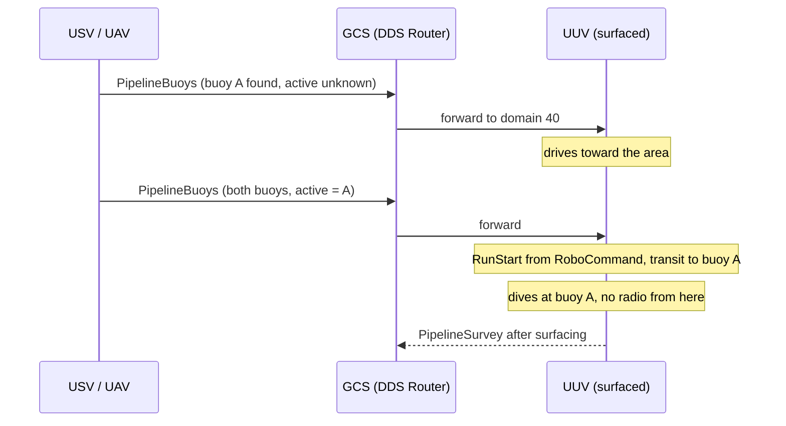

# PipelineBuoys: sending the pipeline buoy positions to the UUV

RobotX 2026 · Task 2 · Team interface proposal

- **From:** UUV team
- **To:** USV team, UAV team, GCS team
- **Status:** accepted, USV-only (October 2026). Merged into `rx_msgs` in
  `rx-sos-communication-itsn` commit `a2a1ccc` with these changes: only the USV publishes
  (`/system/vehicle/usv/task2/pipeline_buoys`, `source_vehicle = TYPE_USV`), and the UUV ignores
  observations tagged with another `course_id`. The UUV receiver is `banyu_communication`
  `pipeline_buoys_node` (issue #16). The fallback when no active buoy arrives before the dive is
  still to be agreed; until then `pipeline_buoys_node` `fallback.enabled` stays false.

The proposal as sent is kept below for reference.

In Task 2 the UUV surveys the pipeline that runs between two buoys. It has to start at the
*active* buoy (the one with the green light), and the survey report sent to RoboCommand is ordered
from that end. Our vehicles find the buoys from above the water, so the USV or UAV should tell the
UUV where they are. This document proposes one small message for that, added to our shared
`rx_msgs` repository.

## What we ask from you

- **USV / UAV:** publish `rx_msgs/PipelineBuoys` once you have found the buoys, and again whenever
  your estimate changes.
- **GCS (DDS Router):** forward that topic from the USV/UAV domains to the UUV domain (40).
- **Everyone:** agree the message below, or tell us what to change, before we add it to `rx_msgs`.

## Why the UUV needs this

- **Where to go.** The UUV drives on the surface to the active buoy and dives there. Today these
  positions are fixed numbers in our config file.
- **Which way the pipe runs.** The line from one buoy to the other gives the pipe direction, which
  the UUV uses to find and follow the pipe on the bottom.
- **Which end is the start.** The active buoy decides where the survey starts and the order of the
  segments in our `PipelineSurvey` report. Getting it wrong makes the report wrong.
- **Timing.** Radio does not work underwater. The UUV must receive this message *before it dives*:
  before the run starts, or while it is still on the surface driving to the buoy.

## Proposed message

One message holds both buoys, so the UUV never has to guess which two separate reports belong
together.

```text
# rx_msgs/msg/PipelineBuoys.msg
# /system/vehicle/<usv|uav>/task2/pipeline_buoys — team extension, not sent to RoboCommand.
# The two buoys at the ends of the Task 2 pipeline, as observed by one vehicle.

std_msgs/Header header        # stamp = time of the newest observation in this message (UTC)
string course_id              # Course.course_id this observation belongs to
uint8 source_vehicle          # VehicleType of the observer (TYPE_USV or TYPE_UAV)
uint32 seq                    # per source; increases whenever the content changes

rx_msgs/LatLng buoy_a         # one pipeline buoy (WGS-84)
rx_msgs/LatLng buoy_b         # the other pipeline buoy
bool buoy_b_valid             # false while only one buoy has been found (put it in buoy_a)

uint8 ACTIVE_UNKNOWN = 0
uint8 ACTIVE_A = 1
uint8 ACTIVE_B = 2
uint8 active_buoy             # which buoy shows the green light (the survey start)

float32 uncertainty_m         # horizontal position error, metres; 0 = unknown
```

### Fields

| Field | Required | Meaning and why |
|---|---|---|
| `buoy_a`, `buoy_b` | must | Latitude/longitude of each buoy, same `LatLng` type as the rest of `rx_msgs`. A and B are just labels; the UUV does not care which is which. |
| `buoy_b_valid` | must | Lets you send the first buoy as soon as you find it. The UUV can start driving toward the area before the second one is known. |
| `active_buoy` | must | Which buoy is active (green). Send `ACTIVE_UNKNOWN` if you cannot tell; never guess. |
| `source_vehicle` | must | Who sent it. If both USV and UAV publish, the UUV can prefer one and log both. |
| `seq` | must | Increase it on every new estimate, so the UUV keeps the newest one even if messages arrive out of order after a link drop. |
| `course_id` | must | Copy it from the `/system/mission/course` message you received. The UUV ignores positions tagged with another course, for example leftovers from practice on a different course. |
| `header.stamp` | recommended | When you actually saw the buoys, not when you sent the message. Lets the UUV ignore old data from an earlier run. Leave it zero if your clock is not synced. |
| `uncertainty_m` | recommended | How far off your position could be, roughly (for example 2 m for a USV that drove next to the buoy, 5–10 m for a UAV estimate from altitude). The UUV searches a wider area when it is large. `0` means "don't know"; that is fine to start with. |

## Topic and delivery

| | |
|---|---|
| Topic | `/system/vehicle/usv/task2/pipeline_buoys` (USV), `/system/vehicle/uav/task2/pipeline_buoys` (UAV) |
| Type | `rx_msgs/PipelineBuoys` |
| QoS | reliable, transient_local, depth 1 (same as `/system/mission/course`) |
| When to publish | As soon as the first buoy is found, on every change, and repeated about once per second until the run ends |
| Routing | DDS Router forwards the topic from USV domain 20 / UAV domain 30 to UUV domain 40 (and to the GCS for display) |

Transient-local plus the once-per-second repeat means the UUV still gets the latest estimate if it
connects late or its Wi-Fi drops for a moment while surfaced.



## What the UUV does with it

1. Ignores the message if `course_id` is not the current course, the position is outside the
   course boundary, or `seq` is older than the one it already has.
2. Uses the newest valid message. If both USV and UAV send one, it prefers the one with a known
   active buoy, then the smaller uncertainty.
3. Drives on the surface to the active buoy, using the line between the buoys as the pipe
   direction, and dives.
4. Keeps updating its target while still on the surface. After diving it can no longer receive
   anything.
5. Reports the active buoy position in its `PipelineSurvey` to RoboCommand.

> **If no message arrives** before the UUV has to dive, or the active buoy stays unknown, the UUV
> falls back to a team-agreed default (a pre-surveyed position, or checking the buoy light itself if
> we build that). We need to agree this fallback together.

## Test it without the UUV

Once the message is in `rx_msgs`, you can publish a sample from your vehicle or a laptop and we can
check our side receives it:

```bash
ROS_DOMAIN_ID=20 ros2 topic pub --qos-durability transient_local --qos-reliability reliable \
  /system/vehicle/usv/task2/pipeline_buoys rx_msgs/msg/PipelineBuoys \
  "{course_id: 'ITSN-SIM-A', source_vehicle: 1, seq: 1,
    buoy_a: {latitude: 33.810438, longitude: -118.393392},
    buoy_b: {latitude: 33.810438, longitude: -118.393272}, buoy_b_valid: true,
    active_buoy: 1, uncertainty_m: 2.0}" -r 1
```

## Questions for you

1. **USV and UAV:** who finds the buoys first, and can you tell which buoy is active (light colour)
   from your sensors?
2. **USV and UAV:** roughly how accurate are your buoy positions? Can you fill `uncertainty_m` and a
   synced `header.stamp`, or should we treat both as optional for now?
3. **GCS:** can the DDS Router forward vehicle-to-vehicle topics (domain 20/30 → 40), or should the
   GCS republish them?
4. **All:** what should the UUV do if the buoy positions or the active buoy are still unknown when
   it is ready to dive?
5. **All:** anything missing from the message for your own tasks? It is easier to add fields now
   than after everyone has built against it.

---

Proposal from the UUV team. Once agreed, the UUV team will open a pull request adding
`PipelineBuoys.msg` and its topic to the `rx_msgs` README, and build the UUV receiver against it.
